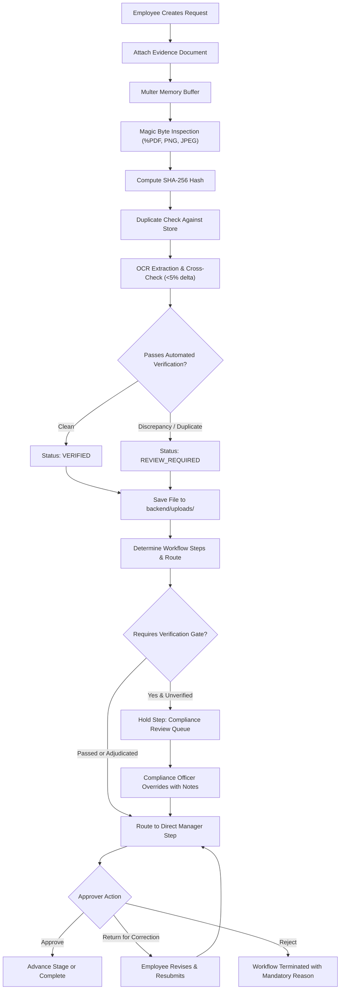

# FlowForge — Complete System Architecture, File Structure & Process Engineering Guide

> **Enterprise-Grade Multi-Stage Workflow Automation, Governance & AI-Assisted Proof Verification Platform**  
> *Authoritative Engineering Reference & Technical Specification*

---

## 📑 Table of Contents

1. [Executive Architectural Philosophy](#1-executive-architectural-philosophy)
2. [Complete Technology Stack & Methodology Matrix](#2-complete-technology-stack--methodology-matrix)
3. [Repository Directory & File Structure](#3-repository-directory--file-structure)
   - [3.1 Backend Architecture](#31-backend-architecture)
   - [3.2 Frontend Architecture](#32-frontend-architecture)
   - [3.3 Documentation & Tooling](#33-documentation--tooling)
4. [Exhaustive Process Workflows & Implementations](#4-exhaustive-process-workflows--implementations)
   - [Process 1: Production Authentication & Session Lifecycle](#process-1-production-authentication--session-lifecycle)
   - [Process 2: Organizational Hierarchy & Corporate Governance Engine](#process-2-organizational-hierarchy--corporate-governance-engine)
   - [Process 3: Multi-Stage Workflow Pipeline & State Machine](#process-3-multi-stage-workflow-pipeline--state-machine)
   - [Process 4: AI-Assisted Documentary Proof & Evidence Verification](#process-4-ai-assisted-documentary-proof--evidence-verification)
   - [Process 5: Interactive Proof Inspection & Media Streaming](#process-5-interactive-proof-inspection--media-streaming)
   - [Process 6: Role-Based Navigation & UI Authorization](#process-6-role-based-navigation--ui-authorization)
   - [Process 7: Notification Center & Append-Only Audit Trail](#process-7-notification-center--append-only-audit-trail)
5. [Complete REST API Endpoint Reference](#5-complete-rest-api-endpoint-reference)
6. [Data Model & Prisma Schema Specifications](#6-data-model--prisma-schema-specifications)
7. [Automated Test Suite & Quality Assurance](#7-automated-test-suite--quality-assurance)
8. [Setup, Execution & Operational Runbook](#8-setup-execution--operational-runbook)

---

## 1. Executive Architectural Philosophy

FlowForge is engineered to replace unstructured, error-prone corporate requisition and approval processes with a resilient, deterministic, and audited pipeline. The design follows four foundational enterprise principles:

1. **Strict Corporate Governance & Segregation of Duties**:
   - **No Self-Approval**: Requesters are strictly forbidden from approving their own submissions, regardless of executive or managerial standing.
   - **ADMIN ≠ APPROVER Rule**: System administrators control infrastructure, user provisioning, and workflow definitions, but cannot rubber-stamp business requests unless explicitly designated as the step approver.
   - **Dynamic Hierarchy Matching**: Requests route dynamically through reporting trees (`managerId`) with cyclic graph detection to prevent infinite approval loops.

2. **Zero-Trust Documentary Proof Verification**:
   - Uploaded receipts, invoices, and certificates are treated as untrusted inputs.
   - Binary inspection verifies authentic magic bytes (`%PDF`, PNG, JPEG, WebP) to prevent MIME spoofing.
   - SHA-256 cryptographic hashing guarantees duplicate claim detection across the entire organization.
   - OCR field extraction cross-references vendor, date, nominal amount, and currency against request payloads, flagging anomalies > 5%.
   - Approvals are locked (`requiresVerificationPassed: true`) until attached evidence passes checks or is cleared by an authorized compliance reviewer.

3. **Deterministic State Machine with Complete Correction Cycles**:
   - Rather than binary Approve/Reject decisions, FlowForge implements `RETURNED_FOR_CORRECTION`. Approvers send claims back with mandatory guidance notes, allowing employees to adjust values, attach clearer proofs, and resubmit directly back into the pipeline.

4. **Immutable Audit Trails & Persistent Notifications**:
   - Every state transition, login, session rotation, proof upload, and compliance adjudication writes to an append-only audit log with user identifiers, timestamps, and metadata payloads.

---

## 2. Complete Technology Stack & Methodology Matrix

| Layer / Subsystem | Technology | Version | Purpose in FlowForge | Key Implementation Method / Pattern |
|---|---|---|---|---|
| **Client UI Framework** | React | `18.3.1` | Component-based Single Page Application (SPA) | Functional components, custom hooks, React Portals |
| **Client Bundler** | Vite | `5.4.6` | High-performance build tool & HMR dev server | ES Modules, Rollup production chunking |
| **Client Language** | TypeScript | `5.6.2` | Static typing across interfaces and state | Strict mode, discriminated unions for state/roles |
| **Server State Management** | TanStack Query | `5.56.2` | Cache management, optimistic mutations, refetching | `useQuery`, `useMutation`, `queryClient.invalidateQueries` |
| **Client Routing** | React Router | `6.26.2` | Declarative client-side routing & route guards | `BrowserRouter`, `Routes`, `Route`, `Navigate`, `RoleRoute` |
| **Styling & Design System** | Tailwind CSS | `3.4.11` | Enterprise glassmorphism dark theme tokens | Custom palette (`forge`), flexbox/grid layout primitives |
| **Iconography** | Lucide React | `0.441.0` | Enterprise iconography and status indicators | Vector SVG tree-shaken icons |
| **HTTP Client** | Axios | `1.7.7` | Asynchronous REST communication | Bearer JWT interceptors, unified error handling |
| **Data Visualization** | Recharts | `2.12.7` | Executive dashboard KPI charts | ResponsiveContainer, BarChart, XAxis, YAxis, Tooltip |
| **Server Runtime** | Node.js | `v20+` / `v22+` | Asynchronous event-driven backend environment | Native Crypto, FileSystem (`fs`), Path, Streams |
| **Backend Framework** | Express.js | `4.22.3` | Modular HTTP API server & middleware pipeline | Express Router, error middleware, JSON parsers |
| **Server Language** | TypeScript | `5.6.2` | Strongly typed backend controllers and services | Compiled with `tsc`, live execution with `ts-node-dev` |
| **Database & ORM** | Prisma ORM | `5.20.0` | PostgreSQL schema modeling & query client | `schema.prisma`, type generation, migrations |
| **Resilient Store** | FlowForge DataStore | Custom | Zero-dependency in-memory DB fallback | Resilient singleton with relational seeding & mocks |
| **Password Security** | Bcrypt | `5.1.1` | One-way salted password hashing | `bcrypt.hash(password, 10)`, `bcrypt.compare()` |
| **Session & Token Auth** | JsonWebToken (JWT) | `9.0.2` | Stateless access & refresh token claims | `jwt.sign()`, `jwt.verify()`, Bearer header & query extraction |
| **HTTP Security Headers** | Helmet | `7.1.0` | Protective response headers (CSP, HSTS, XSS) | Express middleware mounting |
| **Cross-Origin Control** | CORS | `2.8.5` | Strict origin whitelisting (`http://localhost:5173`) | Preflight handling, credential delegation |
| **DDoS / Rate Limiting** | express-rate-limit | `7.4.0` | Protects endpoints against brute-force attacks | 200 requests per 15-minute sliding window per IP |
| **Multipart File Intake** | Multer | `1.4.5-lts` | Secure memory buffering for proof uploads | `multer.memoryStorage()`, 10MB limit enforcement |
| **Cryptographic Hashing** | Node.js `crypto` | Native | Duplicate proof detection & session security | `crypto.createHash('sha256').update(buffer).digest('hex')` |
| **Binary File Inspection** | Node.js `Buffer` | Native | Magic byte header sniffing to block MIME spoofing | Buffer slice comparison for `%PDF`, PNG, JPEG, WebP |
| **Automated Testing** | Vitest | `5.0.5` | Fast unit & integration test runner | `describe`, `it`, `expect`, `beforeEach` |

---

## 3. Repository Directory & File Structure

```
FlowForge/
├── backend/                             # Express.js & TypeScript API Server
│   ├── prisma/
│   │   ├── schema.prisma                # Enterprise PostgreSQL relational data schema
│   │   └── seed.ts                      # Standalone database seeder with bcrypt credentials
│   ├── src/
│   │   ├── config/
│   │   │   └── env.ts                   # Environment variable parser & Zod/default fallbacks
│   │   ├── controllers/                 # HTTP route handlers (Request/Response orchestration)
│   │   │   ├── approval.controller.ts   # Pending queue and decision action endpoints
│   │   │   ├── audit.controller.ts      # Immutable compliance audit log queries
│   │   │   ├── auth.controller.ts       # Login, register, session refresh, role-switch, logout
│   │   │   ├── dashboard.controller.ts  # KPI metric aggregation and chart data
│   │   │   ├── document.controller.ts   # Upload intake, review queue, adjudication, file download
│   │   │   ├── notification.controller.ts# Notification retrieval and read acknowledgments
│   │   │   ├── request.controller.ts    # Request lifecycle (create, list, getById, resubmit, cancel)
│   │   │   ├── user.controller.ts       # User & department directory queries & admin provisioning
│   │   │   └── workflow.controller.ts   # Workflow schema listing and admin pipeline creator
│   │   ├── db/
│   │   │   ├── prisma.ts                # PrismaClient singleton & database health probe
│   │   │   └── store.ts                 # Resilient fallback memory store with demo fixtures
│   │   ├── middleware/
│   │   │   ├── auth.ts                  # JWT verification (Bearer header + query token) & RBAC
│   │   │   └── errorHandler.ts          # Centralized AppError handler with status code resolution
│   │   ├── routes/                      # Modular REST sub-routers
│   │   │   ├── approval.routes.ts       # /api/approvals routes
│   │   │   ├── audit.routes.ts          # /api/audit routes
│   │   │   ├── auth.routes.ts           # /api/auth routes
│   │   │   ├── dashboard.routes.ts      # /api/dashboard routes
│   │   │   ├── document.routes.ts       # /api/documents routes
│   │   │   ├── index.ts                 # Master router aggregation
│   │   │   ├── notification.routes.ts   # /api/notifications routes
│   │   │   ├── request.routes.ts        # /api/requests routes
│   │   │   ├── user.routes.ts           # /api/users routes
│   │   │   └── workflow.routes.ts       # /api/workflows routes
│   │   ├── services/                    # Pure business logic layer
│   │   │   ├── approval.service.ts      # Pipeline advancement, decision rules, threshold checks
│   │   │   ├── audit.service.ts         # Append-only audit logger
│   │   │   ├── auth.service.ts          # Bcrypt hashing, token issuance, session tracking
│   │   │   ├── documentVerification.service.ts # Magic bytes, SHA-256 duplicate check, OCR, disk storage
│   │   │   ├── hierarchy.service.ts     # Reporting chains, loop prevention, permission gates
│   │   │   ├── notification.service.ts  # In-app persistent notification broadcaster
│   │   │   ├── request.service.ts       # Request state machine, resubmissions, cancellations
│   │   │   └── workflow.service.ts      # Step sequence builders and threshold validators
│   │   ├── types/
│   │   │   └── index.ts                 # Core TypeScript interfaces, Enums, DTOs
│   │   ├── __tests__/                   # Vitest automated test suites
│   │   │   ├── auth.test.ts             # Password security, token lifecycle, session revocation
│   │   │   ├── documentVerification.test.ts # Magic bytes, duplicate hashes, compliance overrides
│   │   │   ├── hierarchy.test.ts        # Reporting loops, no self-approval, ADMIN!=APPROVER
│   │   │   └── workflow.test.ts         # Pipeline transitions, corrections, rejections
│   │   ├── app.ts                       # Express application factory with middleware mounting
│   │   └── server.ts                    # HTTP server entry point listening on PORT 5000
│   ├── uploads/                         # Secure disk storage for uploaded evidence files
│   ├── package.json                     # Backend scripts, dependencies, devDependencies
│   ├── tsconfig.json                    # Backend TypeScript configuration
│   └── vitest.config.ts                 # Vitest test runner configuration
│
├── frontend/                            # React 18 / Vite / TypeScript Single Page App
│   ├── src/
│   │   ├── components/
│   │   │   ├── documents/
│   │   │   │   └── ProofViewerModal.tsx # Interactive proof lightbox: zoom, rotate, OCR, SHA-256
│   │   │   ├── layout/
│   │   │   │   ├── AppLayout.tsx        # Shell wrapping Sidebar, Navbar, and Outlet
│   │   │   │   ├── Navbar.tsx           # Global search, notification center, persona switcher
│   │   │   │   └── Sidebar.tsx          # Dynamic role-gated sidebar navigation & hierarchy card
│   │   │   ├── requests/
│   │   │   │   ├── CreateRequestModal.tsx# Form intake modal with drag-and-drop proof uploader
│   │   │   │   └── RequestDetailModal.tsx# Pipeline timeline, payload inspector, proof viewer
│   │   │   └── ui/
│   │   │       ├── Badge.tsx            # Status, role, and workflow type visual badges
│   │   │       ├── Modal.tsx            # Reusable accessible dialog with Esc key support
│   │   │       └── Pagination.tsx       # Table page switcher controls
│   │   ├── context/
│   │   │   ├── AuthContext.tsx          # User state, JWT storage, role-switching, session tracking
│   │   │   └── ToastContext.tsx         # Floating alert feedback toasts
│   │   ├── pages/                       # Application Views
│   │   │   ├── Approvals.tsx            # Approver queue with proof strip & decision modal
│   │   │   ├── AuditLogs.tsx            # Filterable chronological compliance audit trail
│   │   │   ├── Dashboard.tsx            # Metric cards, Recharts analytics, recent activity
│   │   │   ├── DocumentReview.tsx       # Compliance officer queue for flagged proofs & overrides
│   │   │   ├── Login.tsx                # Secure login screen with 6 demo persona quick-logins
│   │   │   ├── Requests.tsx             # Employee request tracker, search, and detail triggers
│   │   │   ├── Settings.tsx             # System parameters, department registry (Admin write)
│   │   │   ├── Team.tsx                 # Organizational roster, reporting tree (Admin write)
│   │   │   └── Workflows.tsx            # Pipeline visualizer and workflow creator (Admin write)
│   │   ├── services/
│   │   │   └── api.ts                   # Axios client instance with Bearer JWT interceptors
│   │   ├── types/
│   │   │   └── index.ts                 # Frontend type definitions mirroring backend entities
│   │   ├── App.tsx                      # Root component: QueryClient, Router, RoleRoute guards
│   │   ├── index.css                    # Tailwind utility directives and custom glassmorphism
│   │   └── main.tsx                     # React DOM entry point
│   ├── package.json                     # Frontend dependencies and Vite scripts
│   ├── tsconfig.json                    # Frontend TypeScript configuration
│   ├── vite.config.ts                   # Vite bundler plugins and dev server settings
│   └── tailwind.config.js               # Theme configuration with custom `forge` dark tokens
│
├── docs/                                # Technical & Architectural Documentation
│   ├── IMPLEMENTATION_AUDIT.md          # Architecture and security vulnerability audit
│   ├── SECURITY_AND_AI_LIMITATIONS.md   # AI boundaries, fraud ethics, technical limitations
│   ├── IMPLEMENTATION_STATUS.md         # Milestone tracking and stage verification log
│   └── SYSTEM_ARCHITECTURE_AND_PROCESS_GUIDE.md # This comprehensive document
└── README.md                            # High-level project summary and quickstart
```

---

## 4. Exhaustive Process Workflows & Implementations



---

### Process 1: Production Authentication & Session Lifecycle

#### Objective
Ensure cryptographic user authentication, prevent credential leakage, manage token rotation, and enforce strict session revocation.

#### Technologies & Libraries
- `bcrypt`: 10 salt rounds for irreversible salted password hashing.
- `jsonwebtoken`: HMAC-SHA256 tokens (`accessToken` with 15m lifetime, `refreshToken` with 7d lifetime).
- `Session` relational entity: Tracks active sessions and cryptographic token hashes.
- `localStorage`: Client-side token caching.

#### Method Implementation Details
1. **Password Hashing & Verification**:
   - In [`AuthService.hashPassword`](file:///c:/Users/anshg/OneDrive/Desktop/FlowForge/backend/src/services/auth.service.ts), new accounts are hashed via `bcrypt.hash(password, 10)`. Plaintext passwords are never persisted.
   - During login ([`AuthService.login`](file:///c:/Users/anshg/OneDrive/Desktop/FlowForge/backend/src/services/auth.service.ts)), the stored hash is verified via `bcrypt.compare(password, user.passwordHash)`.
2. **Dual-Token Generation & Session Rotation**:
   - `AuthService.generateTokens(user)` issues an ephemeral access token and a refresh token.
   - The token hash is recorded in `db.sessions` with an explicit `expiresAt` timestamp.
3. **Authentication Middleware ([`auth.ts`](file:///c:/Users/anshg/OneDrive/Desktop/FlowForge/backend/src/middleware/auth.ts))**:
   - Intercepts requests and inspects `Authorization: Bearer <token>`.
   - **Query Parameter Fallback**: Accepts `req.query.token` for direct browser streaming of images and PDF files (`/api/documents/:id/download?token=...`).
   - Rejects missing, invalid, or expired tokens with `HTTP 401 Unauthorized`.
   - Validates that the account is not suspended (`user.status !== 'SUSPENDED'`), returning `HTTP 403 Forbidden` if locked.
4. **Logout & Session Revocation**:
   - [`AuthService.logout`](file:///c:/Users/anshg/OneDrive/Desktop/FlowForge/backend/src/services/auth.service.ts) sets `revokedAt = new Date().toISOString()`, preventing replay of previously issued session tokens.

---

### Process 2: Organizational Hierarchy & Corporate Governance Engine

#### Objective
Model realistic enterprise reporting lines and enforce governance safeguards that eliminate corporate fraud and managerial bypass.

#### Technologies & Libraries
- Directed Graph Algorithms (Breadth-First Search, Set-based cycle detection).
- [`HierarchyService`](file:///c:/Users/anshg/OneDrive/Desktop/FlowForge/backend/src/services/hierarchy.service.ts).

#### Method Implementation Details

1. **Reporting Chain Resolution & Loop Prevention**:
   - [`HierarchyService.getReportingChain(userId)`](file:///c:/Users/anshg/OneDrive/Desktop/FlowForge/backend/src/services/hierarchy.service.ts) traverses upward through `user.managerId`.
   - Maintains a `visited = new Set<string>()`. If a cycle exists (e.g. A reports to B, B reports to A), traversal breaks immediately, preventing infinite loops:
     ```typescript
     while (currentId) {
       if (visited.has(currentId)) break;
       visited.add(currentId);
       const currentUser = db.users.find(u => u.id === currentId);
       if (!currentUser?.managerId) break;
       const manager = db.users.find(u => u.id === currentUser.managerId);
       if (manager) { chain.push(manager); currentId = manager.id; } else break;
     }
     ```

2. **Subordinate Traversal**:
   - [`HierarchyService.getSubordinates(managerId)`](file:///c:/Users/anshg/OneDrive/Desktop/FlowForge/backend/src/services/hierarchy.service.ts) uses a BFS queue to locate all direct and indirect reports in an organization branch.

3. **Corporate Governance Rules ([`HierarchyService.canUserApprove`](file:///c:/Users/anshg/OneDrive/Desktop/FlowForge/backend/src/services/hierarchy.service.ts))**:
   * **Rule 1: Strict Self-Approval Prohibition**:
     If `user.id === request.requesterId`, approval is rejected (`allowed: false, reason: 'Self-approval is strictly prohibited'`).
   * **Rule 2: ADMIN ≠ APPROVER Separation of Concerns**:
     If `user.role === 'ADMIN'`, the user cannot approve business requests unless the step explicitly designates `approverRole: 'ADMIN'` or specific `approverId: user.id`. System admins cannot arbitrarily override business workflows.
   * **Rule 3: Dynamic Direct Manager Routing (`useDirectManager: true`)**:
     The step approver must be in the requester's direct reporting chain. Unrelated managers attempting to decide the request receive `HTTP 403 Forbidden`.
   * **Rule 4: Evidence Verification Gate (`requiresVerificationPassed: true`)**:
     Approval actions are blocked if attached documents remain in `PROCESSING`, `VERIFICATION_FAILED`, or un-adjudicated `REVIEW_REQUIRED` states.

---

### Process 3: Multi-Stage Workflow Pipeline & State Machine

#### Objective
Orchestrate sequential multi-stakeholder approval pipelines with dynamic branching and employee correction loops.

#### Technologies & Libraries
- Deterministic State Machine in [`ApprovalService`](file:///c:/Users/anshg/OneDrive/Desktop/FlowForge/backend/src/services/approval.service.ts) and [`RequestService`](file:///c:/Users/anshg/OneDrive/Desktop/FlowForge/backend/src/services/request.service.ts).

#### State Machine Flow
```
[DRAFT] ──> [SUBMITTED] ──> [PENDING_APPROVAL (Step 1)]
                                   │
         ┌─────────────────────────┼─────────────────────────┐
         ▼                         ▼                         ▼
    [APPROVED]             [REJECTED]            [RETURNED_FOR_CORRECTION]
         │                     (Terminated)                  │
         ├─> More Steps?                                     │ (Employee edits & resubmits)
         │   ├─ Yes ──> [PENDING_APPROVAL (Step 2)]          │
         │   └─ No  ──> [COMPLETED]                          ▼
         │                                            [RESUBMITTED]
         └───────────────────────────────────────────────────┘
```

#### Method Implementation Details
1. **Sequential Advancement**:
   - When an authorized approver calls `POST /api/approvals/:id/action` with `action: 'APPROVED'`:
     - Creates an immutable record in `db.approvals`.
     - Queries `db.workflowSteps` for `order: currentStep.order + 1`.
     - If a subsequent step exists, advances `request.currentStepId` to that step.
     - If no further steps exist, marks `request.status = 'COMPLETED'`.
2. **Amount Threshold Branching**:
   - If a purchase requisition nominal value is below the workflow threshold (e.g. `< $1,000`), the engine automatically skips executive escalation steps and routes directly to final clearance.
3. **Rejection Handling**:
   - Requires a non-empty `comment` parameter.
   - Immediately transitions `request.status = 'REJECTED'`, halts pipeline progression, and records the termination reason.
4. **Correction Loop (`RETURNED_FOR_CORRECTION`)**:
   - Approvers identify flaws in receipts, miscalculated amounts, or missing data and select "Return for Correction" with mandatory explanatory notes.
   - Status transitions to `RETURNED_FOR_CORRECTION`.
   - The employee receives a notification and sees an alert banner on their request view.
   - The employee edits values or uploads revised files and calls `PATCH /api/requests/:id/resubmit`, which returns the request to `PENDING_APPROVAL` at the original step.

---

### Process 4: AI-Assisted Documentary Proof & Evidence Verification

#### Objective
Validate uploaded financial receipts, medical certificates, and purchase invoices against fraud, tampering, and clerical errors before approvals take place.

#### Technologies & Libraries
- `multer`: Memory buffering to prevent temporary disk vulnerability exploitation.
- `crypto`: Node.js cryptographic SHA-256 digest computation.
- Buffer Magic Byte Analysis: Raw binary inspection.
- Optical Character Recognition (OCR) Heuristic Engine: Field parsing and cross-validation.
- [`DocumentVerificationService`](file:///c:/Users/anshg/OneDrive/Desktop/FlowForge/backend/src/services/documentVerification.service.ts).

#### Method Implementation Details

1. **Magic Byte Signature Inspection**:
   - Inspects the first 4 to 12 bytes of the file buffer to verify true binary format against declared MIME types:
     ```typescript
     // PDF: %PDF (hex 25 50 44 46)
     buffer[0] === 0x25 && buffer[1] === 0x50 && buffer[2] === 0x44 && buffer[3] === 0x46
     // PNG: 89 50 4E 47 0D 0A 1A 0A
     buffer[0] === 0x89 && buffer[1] === 0x50 && buffer[2] === 0x4e && buffer[3] === 0x47
     // JPEG: FF D8 FF
     buffer[0] === 0xff && buffer[1] === 0xd8 && buffer[2] === 0xff
     // WebP: RIFF....WEBP
     buffer.subarray(0, 4).toString('ascii') === 'RIFF' && buffer.subarray(8, 12).toString('ascii') === 'WEBP'
     ```
   - If magic bytes do not match the declared MIME type, the file is flagged with `VERIFICATION_FAILED` to counter MIME-spoofing attacks.

2. **SHA-256 Duplicate Claim Detection**:
   - Computes `crypto.createHash('sha256').update(buffer).digest('hex')`.
   - Queries `db.documents` across all historical claims. If an identical hash is found on a different claim, sets `status = 'REVIEW_REQUIRED'` and flags:
     `"Cryptographic duplicate detected: identical file payload previously uploaded as <filename>"`
   - This instantly stops employees from submitting the same receipt to multiple expense claims.

3. **OCR Extraction & Discrepancy Cross-Checking**:
   - Parses vendor name, invoice date, currency, line items, and nominal amount.
   - **Cross-check Formula**:
     $$\text{discrepancy} = \frac{|\text{extractedAmount} - \text{requestedAmount}|}{\text{requestedAmount}}$$
     If $\text{discrepancy} > 0.05$ (greater than 5%), flags `checks.amountConsistency = false` and sets status to `REVIEW_REQUIRED`.

4. **Forensic Integrity Heuristics**:
   - Inspects image resolution. If DPI < 150, flags diffuse text boundaries and drops confidence to 0.65.
   - Evaluates font smoothing anomalies and metadata revision traces.

5. **Physical Disk Persistence**:
   - Sanitizes filenames and saves verified buffers to `backend/uploads/${Date.now()}-${safeFilename}`.

6. **Human Compliance Adjudication**:
   - Authorized officers access `/documents/review` to inspect flagged files.
   - Calling `POST /api/documents/:id/review` with `action: 'VERIFY' | 'REJECT'` and mandatory justification notes overrides the automated flag, unlocks verification gates, and appends to the immutable audit trail.

---

### Process 5: Interactive Proof Inspection & Media Streaming

#### Objective
Empower approvers to inspect, zoom, rotate, and verify uploaded evidence directly within their review workflows without leaving the approval interface.

#### Technologies & Libraries
- Frontend: [`ProofViewerModal.tsx`](file:///c:/Users/anshg/OneDrive/Desktop/FlowForge/frontend/src/components/documents/ProofViewerModal.tsx).
- Backend: [`DocumentController.download`](file:///c:/Users/anshg/OneDrive/Desktop/FlowForge/backend/src/controllers/document.controller.ts) with streaming and SVG vector generation.

#### Method Implementation Details
1. **Direct Approver Proof Strip**:
   - In [`Approvals.tsx`](file:///c:/Users/anshg/OneDrive/Desktop/FlowForge/frontend/src/pages/Approvals.tsx), each pending card checks for attached documents and renders a proof thumbnail, file name, status badge, and **"View Proof"** button.
   - In the Decision Modal, a proof summary displays so approvers can re-examine receipts right while composing their approval or rejection remarks.
2. **Interactive Proof Lightbox (`ProofViewerModal`)**:
   - Renders original image files with zoom controls (`scale(zoom)`), rotation (`rotate(deg)`), and drag-to-inspect.
   - Embeds PDF documents inside an interactive iframe.
   - Displays side-by-side OCR data, verification checklist, copyable SHA-256 hash, and download buttons.
3. **Universal SVG Fallback for Seed Records**:
   - When a requested file is a pre-seeded demonstration record without a physical disk file, the backend dynamically constructs and streams a vector SVG proof card with `Content-Type: image/svg+xml`, ensuring previews and thumbnails never render broken image icons.

---

### Process 6: Role-Based Navigation & UI Authorization

#### Objective
Ensure that users see only the navigation items, queues, and administration tools appropriate to their organizational role.

#### Implementation Details
1. **Dynamic Navigation Filtering ([`Sidebar.tsx`](file:///c:/Users/anshg/OneDrive/Desktop/FlowForge/frontend/src/components/layout/Sidebar.tsx))**:
   - Navigation items declare `allowedRoles: Role[]`.
   - The sidebar filters `navigationItems.filter(item => item.allowedRoles.includes(currentRole))`.

#### Role Access Mapping Table

| Feature / Navigation Item | Route | EMPLOYEE | MANAGER | DEPARTMENT_HEAD | HR | FINANCE | ADMIN |
|---|---|:---:|:---:|:---:|:---:|:---:|:---:|
| **Dashboard** | `/` | ✅ | ✅ | ✅ | ✅ | ✅ | ✅ |
| **My Requests** | `/requests` | ✅ (Own Only) | ✅ (All) | ✅ (All) | ✅ (All) | ✅ (All) | ✅ (All) |
| **Approvals Queue** | `/approvals` | ❌ | ✅ | ✅ | ✅ | ✅ | ✅ (Restricted) |
| **Evidence Review** | `/documents/review` | ❌ | ✅ | ✅ | ✅ | ✅ | ✅ |
| **Workflows** | `/workflows` | ❌ | ❌ | ✅ (View) | ❌ | ❌ | ✅ (Create & Edit) |
| **Audit Trail** | `/audit` | ❌ | ❌ | ✅ | ✅ | ✅ | ✅ |
| **Team & Hierarchy** | `/users` | ❌ | ✅ (View) | ✅ (View) | ✅ (View) | ❌ | ✅ (Add Users) |
| **System Settings** | `/settings` | ❌ | ❌ | ❌ | ❌ | ❌ | ✅ (Add Depts) |

2. **Route Guarding ([`App.tsx`](file:///c:/Users/anshg/OneDrive/Desktop/FlowForge/frontend/src/App.tsx))**:
   - Protected routes are wrapped in `<RoleRoute allowedRoles={[...]}>`.
   - Direct URL access to unauthorized pages immediately redirects the user back to `/`.
3. **Admin-Only "Add Member" Enforcement ([`Team.tsx`](file:///c:/Users/anshg/OneDrive/Desktop/FlowForge/frontend/src/pages/Team.tsx))**:
   - The `+ Add Member` button and modal are gated behind `{isAdmin && ( ... )}`. Non-admin roles (Managers, Dept Heads, HR) cannot provision users.
   - Backend endpoint `POST /api/users` enforces `requireRole(['ADMIN'])`.

---

### Process 7: Notification Center & Append-Only Audit Trail

#### Objective
Maintain complete situational awareness and an unimpeachable historical record of all organizational actions.

#### Implementation Details
1. **Persistent In-App Notifications**:
   - Stored in `db.notifications` with `userId`, `title`, `message`, `type`, `link`, `isRead`, and `createdAt`.
   - Triggered upon request submissions, stage advancements, returns, approvals, rejections, and evidence flags.
   - The Navbar bell displays an unread count badge with polling updates every 10 seconds.
   - Supports 1-click navigation to the affected request and "Mark All Read".
2. **Immutable Audit Logging**:
   - Handled via `AuditService.logAction(userId, userName, role, action, entity, entityId, details)`.
   - Captures logins, token rotations, request state transitions, document uploads, and human compliance adjudications.
   - Accessible via `/audit` with filterable date, entity, and actor dimensions.

---

## 5. Complete REST API Endpoint Reference

### Authentication (`/api/auth`)
| Method | Endpoint | Protection | Description |
|---|---|---|---|
| `POST` | `/api/auth/login` | Public | Authenticates credentials with bcrypt, issues access & refresh tokens |
| `POST` | `/api/auth/register` | Public | Registers a new user with hashed password storage |
| `POST` | `/api/auth/refresh` | Public | Rotates access token via valid refresh token |
| `POST` | `/api/auth/logout` | Authenticated | Revokes active session in database |
| `GET` | `/api/auth/me` | Authenticated | Returns current profile and reporting manager |
| `POST` | `/api/auth/switch-role` | Authenticated | Switches demo persona and issues new role tokens |

### Requests (`/api/requests`)
| Method | Endpoint | Protection | Description |
|---|---|---|---|
| `GET` | `/api/requests` | Authenticated | Lists requests (filtered by `requesterId` for EMPLOYEE, all for managers) |
| `GET` | `/api/requests/:id` | Authenticated | Fetches complete request details, timeline, approvals, and documents |
| `POST` | `/api/requests` | Authenticated | Submits new request and initiates workflow step 1 |
| `PATCH` | `/api/requests/:id/resubmit` | Authenticated | Resubmits request returned for correction |
| `PATCH` | `/api/requests/:id/cancel` | Authenticated | Cancels a pending request (requester only) |

### Approvals (`/api/approvals`)
| Method | Endpoint | Protection | Description |
|---|---|---|---|
| `GET` | `/api/approvals/pending` | Authenticated | Returns requests pending decision for the current user's role and hierarchy |
| `POST` | `/api/approvals/:id/action` | Authenticated | Executes `APPROVED`, `REJECTED`, or `RETURNED_FOR_CORRECTION` |

### Document Evidence (`/api/documents`)
| Method | Endpoint | Protection | Description |
|---|---|---|---|
| `POST` | `/api/documents/upload` | Authenticated | Multer upload, magic byte check, SHA-256 hash, OCR, saves to disk |
| `GET` | `/api/documents/request/:requestId` | Authenticated | Retrieves all attached evidence records for a request |
| `GET` | `/api/documents/review-queue` | Authenticated | Fetches documents flagged with `REVIEW_REQUIRED` or `VERIFICATION_FAILED` |
| `POST` | `/api/documents/:id/review` | Authenticated | Adjudicates document (`VERIFY` / `REJECT`) with mandatory audit notes |
| `GET` | `/api/documents/:id/download` | Auth (Header/Query) | Streams file from disk or generates vector SVG proof preview |

### Workflows & Administration (`/api/workflows`, `/api/users`)
| Method | Endpoint | Protection | Description |
|---|---|---|---|
| `GET` | `/api/workflows` | Authenticated | Lists all active workflow pipeline definitions |
| `POST` | `/api/workflows` | `requireRole(['ADMIN'])` | Creates a new multi-stage sequential workflow pipeline |
| `GET` | `/api/users` | Authenticated | Lists team members and reporting hierarchies |
| `POST` | `/api/users` | `requireRole(['ADMIN'])` | Provisions a new user account |
| `GET` | `/api/users/departments` | Authenticated | Lists registered organizational departments |
| `POST` | `/api/users/departments` | `requireRole(['ADMIN'])` | Registers a new company department |

### System & Health (`/api/system`)
| Method | Endpoint | Protection | Description |
|---|---|---|---|
| `GET` | `/api/health` | Public | Health status, uptime, environment, and DB connectivity probe |
| `GET` | `/api/dashboard/stats` | Authenticated | KPI counts tailored to the user's role |
| `GET` | `/api/dashboard/charts` | Authenticated | Workflow distribution by type, status, and recent activity |
| `GET` | `/api/audit` | Authenticated | Queryable immutable compliance audit trail |
| `GET` | `/api/notifications` | Authenticated | Active user in-app notifications and unread tally |

---

## 6. Data Model & Prisma Schema Specifications

FlowForge's relational architecture is defined in [`backend/prisma/schema.prisma`](file:///c:/Users/anshg/OneDrive/Desktop/FlowForge/backend/prisma/schema.prisma):

```
┌──────────────┐       ┌─────────────────┐       ┌──────────────────┐
│     User     │──────<│     Request     │>──────│ RequestDocument  │
└──────────────┘       └─────────────────┘       └──────────────────┘
       │                        │
       │ (Reporting)            │ (Step Sequence)
       ▼                        ▼
┌──────────────┐       ┌─────────────────┐       ┌──────────────────┐
│  Department  │       │  WorkflowStep   │>──────│     Approval     │
└──────────────┘       └─────────────────┘       └──────────────────┘
```

### Core Entity Definitions:
* **`User`**: Core identity model with `managerId` self-relation (direct manager hierarchy), `departmentId`, `role` enum, `passwordHash`, and `status` (`ACTIVE`/`SUSPENDED`).
* **`Department`**: Organizational divisions linked to a Department Head (`managerId`).
* **`Workflow`**: Pipelines with `type` (LEAVE, PURCHASE, EXPENSE), `amountThreshold` (triggering executive review), `requiresDocuments`, and `requiredDocumentTypes`.
* **`WorkflowStep`**: Individual approval gates with `order`, `approverRole`, `useDirectManager` (dynamic reporting tree routing), and `requiresVerificationPassed` (evidence gate lock).
* **`Request`**: The central submission entity tracking `status`, payload `data` (JSON), requester relations, and step pointer `currentStepId`.
* **`RequestDocument`**: Uploaded evidence records storing `storagePath`, `fileHash` (SHA-256 duplicate key), `mimeType`, `status` (`PROCESSING`, `VERIFIED`, `REVIEW_REQUIRED`, `VERIFICATION_FAILED`, `REJECTED`), `ocrExtracted` JSON, and compliance reviewer overrides.
* **`Approval`**: Immutable decision logs recording `action` (`APPROVED`, `REJECTED`, `RETURNED_FOR_CORRECTION`), approver relation, and justification `comment`.
* **`Session`**: Ephemeral token session hashes supporting revocation and rotation.
* **`Notification`**: In-app persistent alerts with `isRead` states and navigation target links.
* **`AuditLog`**: Append-only compliance log capturing all platform activity.

---

## 7. Automated Test Suite & Quality Assurance

FlowForge maintains automated test suites in `backend/src/__tests__/` running on Vitest:

```bash
cd backend
npm test
```

### Coverage (20 / 20 Passing Tests):
1. **`auth.test.ts` (5 Tests)**:
   - Verifies Bcrypt salted password comparison.
   - Rejects incorrect credentials with HTTP 401.
   - Validates user registration with hashed password persistence.
   - Enforces JWT session rotation and refresh token exchange.
   - Confirms session revocation and invalidation upon logout.
2. **`hierarchy.test.ts` (7 Tests)**:
   - Resolves direct reporting managers via `managerId`.
   - Prevents cyclic reporting loops using visited graph set traversal.
   - Enforces Rule 1: Strict Self-Approval Prohibition (`CANNOT_SELF_APPROVE`).
   - Enforces Rule 2: ADMIN ≠ APPROVER rule (system admins cannot approve business workflows).
   - Validates dynamic direct manager step routing (`useDirectManager: true`).
   - Rejects approval attempts by unrelated managers.
   - Enforces document verification gating locks (`requiresVerificationPassed: true`).
3. **`workflow.test.ts` (4 Tests)**:
   - Verifies multi-stage pipeline advancement from Step 1 to Step 2.
   - Validates workflow completion upon final step clearance.
   - Validates the `RETURNED_FOR_CORRECTION` lifecycle and employee resubmission.
   - Rejects decisions lacking mandatory justification notes on rejection.
4. **`documentVerification.test.ts` (4 Tests)**:
   - Verifies authentic PDF magic bytes signature sniffing (`%PDF`).
   - Confirms instant detection of duplicate file uploads using SHA-256 hashes.
   - Validates human compliance reviewer adjudication and state transitions.
   - Rejects compliance overrides lacking mandatory reviewer notes.

---

## 8. Setup, Execution & Operational Runbook

### Prerequisites
- **Node.js**: v20+ or v22 LTS
- **npm**: v10+

### Starting Development Servers
```bash
# Terminal 1 — Backend API Server
cd backend
npm install
npm test            # Run 20/20 Vitest automated suites
npm run build       # Verify TypeScript compilation (tsc)
npm run dev         # Launches Express API on http://localhost:5000

# Terminal 2 — Frontend Application
cd frontend
npm install
npm run build       # Verify bundle compilation (tsc && vite build)
npm run dev         # Launches Vite dev server on http://localhost:5173
```

### Pre-Configured Demo Personas
Log in at `http://localhost:5173/login` or use the instant persona switcher in the top navigation bar:

| Role | Persona Name | Email | Default Password | Department |
|---|---|---|---|---|
| **EMPLOYEE** | Alex Rivera | `employee@flowforge.internal` | `Password123!` | Engineering |
| **MANAGER** | Sarah Connor | `manager@flowforge.internal` | `Password123!` | Engineering |
| **DEPARTMENT_HEAD** | Victoria Chase | `head.eng@flowforge.internal` | `Password123!` | Engineering |
| **HR** | Jessica Pearson | `hr@flowforge.internal` | `Password123!` | Human Resources |
| **FINANCE** | Michael Scott | `finance@flowforge.internal` | `Password123!` | Finance & Accounts |
| **ADMIN** | Rachel Zane | `admin@flowforge.internal` | `Password123!` | Operations |

